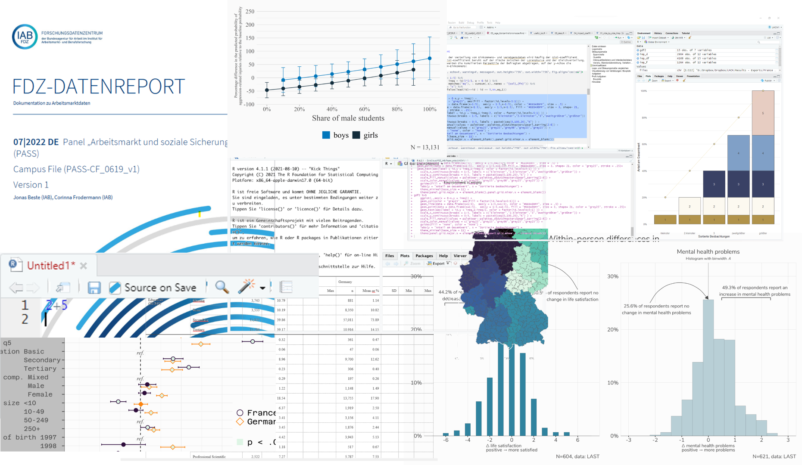

# Welcome! {#index .unnumbered}

```{r indx, include=F}
library(kableExtra)
library(tidyverse)
source("00_libpath.R")
```

Introduction to R for GradAB and IAB people.

<!-- {width="490"} -->


```{r main, echo = F, out.height="70%",out.width="70%", fig.align="center"}

```


## Course dates {.unnumbered}

::: {.g-col-12 .g-col-sm-6 .g-col-md-4}

 &ensp; 26.10.2026 &ensp;  &ensp; 9:00 – 16:00 &ensp;  &ensp; EB 558

 &ensp; 26.10.2026 &ensp;  &ensp; 9:00 – 16:00 &ensp;  &ensp; EB 433

:::
